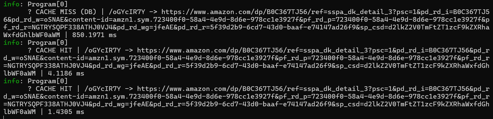

# UrlShortener


A lightweight URL shortener API built with **ASP.NET Core Minimal APIs**, **Entity Framework Core**, **SQLite**, and a **Redis cache-aside layer** for fast redirects.

## Why Redis? See the impact

Redirects are the hottest path of a URL shortener: one link is created once but read many times. Caching the `shortCode -> originalUrl` mapping in Redis removes the database from the hot path.



Real logs from a local run (same short link, requested three times):

| Request | Result | Response time |
|---------|--------|---------------|
| 1st | CACHE MISS (database lookup + store in Redis) | **~850 ms** |
| 2nd | CACHE HIT (served from Redis) | **~4.1 ms** |
| 3rd | CACHE HIT (served from Redis) | **~1.4 ms** |

That is roughly a **200x to 600x** improvement on repeated reads.

> **Note:** the first request also includes one-time warm-up costs (EF Core model initialization, first SQLite and Redis connections), so ~850 ms is not the steady-state database latency. The gap shrinks with a warm database, but it grows again with a remote database (PostgreSQL / SQL Server) and under concurrent load, which is exactly where a cache pays off.

## Features

- Shorten any valid `http` / `https` URL into an 8-character code
- Fast redirects with **Redis cache-aside** (24h TTL)
- SQLite persistence with EF Core migrations
- Response-time logging and `X-Cache` / `X-Response-Time-Ms` headers on every redirect
- Swagger UI in development

## Architecture

```
                 +-------------------+
 Client -------> |  ASP.NET Core API | ---- hit ----> Redis (cache)
                 +-------------------+
                          |
                        miss
                          v
                      SQLite (EF Core)
```

### Redirect flow (`GET /{shortCode}`)

1. The client requests the short link
2. The API checks **Redis** first
3. **Cache hit:** redirect immediately
4. **Cache miss:** query the database, store the result in Redis (TTL 24h), then redirect
5. Unknown code: `404 Not Found`

## Tech Stack

- C# / .NET 8
- ASP.NET Core Minimal APIs
- Entity Framework Core (SQLite provider)
- Redis via `Microsoft.Extensions.Caching.StackExchangeRedis`
- Swagger / OpenAPI
- Docker, GitHub Actions

## Getting Started

### Prerequisites

- [.NET 8 SDK](https://dotnet.microsoft.com/download)
- [Docker](https://www.docker.com/) (only to run Redis)
- EF Core tools: `dotnet tool install --global dotnet-ef`

### 1. Start Redis (only Redis in a container)

```bash
docker run -d --name redis-urlshortener -p 6379:6379 redis:7-alpine
```

### 2. Run the API locally

```bash
git clone https://github.com/USERNAME/UrlShortener.git
cd UrlShortener/UrlShortener
dotnet ef database update
dotnet run
```

Open Swagger at `https://localhost:<port>/swagger` (the port is printed in the console).

### Configuration

`appsettings.json`:

```json
"ConnectionStrings": {
  "DefaultConnection": "Data Source=app.db",
  "Redis": "localhost:6379"
}
```

## API

### Create a short URL

`POST /shorten`

```json
{
  "url": "https://www.example.com/some/very/long/path"
}
```

Response:

```json
{
  "url": "https://localhost:7000/aB3dE9xZ"
}
```

### Redirect

`GET /{shortCode}` returns a redirect to the original URL, or `404` if the code does not exist.

## Verify the cache yourself

**1. Watch Redis commands live:**

```bash
docker exec -it redis-urlshortener redis-cli monitor
```

**2. Open the short link twice.** The first request shows a `GET` followed by a write (miss), the second only a `GET` (hit). The API console also logs:

```
CACHE MISS (DB) | /oGYcIR7Y -> https://... | 850.1971 ms
CACHE HIT       | /oGYcIR7Y -> https://... | 4.1186 ms
CACHE HIT       | /oGYcIR7Y -> https://... | 1.4305 ms

```

**3. Inspect response headers:**

```bash
curl -k -s -o /dev/null -D - https://localhost:7xxx/<shortCode>
```

Look for `X-Cache: HIT` or `X-Cache: MISS`.

**4. Prove the cache is serving traffic:** open a link (miss, then hit), delete its row from the database, and open it again. It still redirects because Redis answers. Run `redis-cli flushall` and it returns `404`.

## Project Structure

```
UrlShortener/
├── Migrations/              # EF Core migrations
├── Models/
│   ├── UrlDto.cs                # Incoming request model
│   ├── UrlManagement.cs         # Database entity
│   └── UrlShortResponseDto.cs   # Response model
├── docs/
│   └── redis-cache-impact.png   # Cache benchmark screenshot
├── Program.cs               # Endpoints, DbContext, caching logic
└── UrlShortener.http        # Sample requests
```

## System Design Notes

| Topic | Current (v1.0.0) | Production approach |
|-------|------------------|---------------------|
| Caching | Redis cache-aside, 24h TTL | Same, plus `allkeys-lru` eviction and cache invalidation on delete/update |
| Database | SQLite (single file) | PostgreSQL / SQL Server with read replicas |
| Short code generation | Random 8 chars (62^8 ≈ 218 trillion) | Base62 of a distributed ID (Snowflake) to avoid collisions |
| Scaling | Single instance | Stateless API behind a load balancer |
| Rate limiting | None | ASP.NET Core `RateLimiter` middleware / API gateway |
| Observability | Console logs + response headers | Serilog, Prometheus, Grafana, health checks |
| Analytics | None | Async click counting via a message queue (RabbitMQ / Kafka) |

## DevOps

- **Containerization:** Docker (multi-stage build)
- **Local orchestration:** Docker Compose (API + Redis)
- **CI:** GitHub Actions (restore, build, test, docker build)
- **Deployment targets:** Azure App Service / Container Apps, AWS ECS, Fly.io, Railway, or any VPS with Docker

## Roadmap

- [ ] Switch to PostgreSQL
- [ ] Unique index on `ShortUrl` and collision handling
- [ ] Rate limiting
- [ ] Custom aliases and link expiry
- [ ] Click analytics
- [ ] Health checks and metrics
- [ ] CD pipeline to the cloud

## License

MIT
